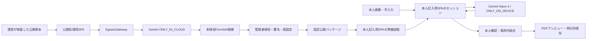

# FormTwin アーキテクチャ設計書（修正版）

改訂日：2026年11月12日（公式ルール反映）  
状態：セキュリティレビューおよび最終通しレビューを反映した設計。実装・実機の検証完了を示すものではない。

## 1. 目的・対象範囲・決定事項

公開書式の解析をクラウドで行い、本人の書類・入力値の抽出、確認、書式への結合、PDF出力を端末内で行う。クラウド側で生成した欄定義をそのまま実行せず、検収・版固定した対応表として端末へ配布する。

MVP範囲・受入基準・実装日程は同日付の「FormTwin 要件定義書（修正版）」を正とする。本書は境界と状態契約、技術スタック選定書は採用技術と配置を定める。3文書は独立した2つのSPA・非永続・固定様式1種類に統一し、変更時は同時に更新する。端末推論のFirebase AI Logic採用は維持するが、SDKが存在することと外部通信を許可することを区別する。

| 項目 | MVPでの決定 |
| --- | --- |
| 対象書式 | 在留期間更新許可申請書から1種類・1版。対象在留資格・対応欄・公式原本は成立ゲートで固定 |
| 本人書類 | 架空の在留カード画像。JPEG/PNGのみ。旅券追加はDay 2の成立ゲート通過後に判断 |
| UI・説明 | 本人向けの開始・準備・入力・修正・確認・エラー・保存・終了は英語。対応欄はレビュー済み英語説明を表示し、公式様式の日本語と本人情報の原表記を保持 |
| クラウド入力 | 運営が確認した公開原本と固定プロンプトだけ |
| 本人データ | MVPは一時セッションのみ。メモリ内で処理し、IndexedDB等に永続保存せず、保管庫用の鍵も作らない |
| 実行環境 | 公開処理用SPAと本人記入用SPAを別オリジン・別ビルドで配布 |
| 端末推論 | Firebase AI Logic経由のGemini Nano 4を対象とする `ONLY_ON_DEVICE`。世代の利用根拠を実機確認し、失敗時は手入力 |
| クラウド推論 | 公開処理側だけで `ONLY_IN_CLOUD` |
| 出力 | 確認済みの対応欄を記入したPDFのプレビュー・明示的保存。提出可能とは表示しない |
| オフライン | 準備済みの開いている画面で抽出・確認・出力。初回起動・再読込みは保証対象外 |
| 延期 | 任意PDF取込、利用者投稿、支援者用複数人運用、永続保管庫、PWA、検索グラウンディング、few-shot自動生成 |

## 2. 保護対象と保証範囲

### 2.1 データ分類

| 分類 | 対象 | 許可される扱い |
| --- | --- | --- |
| 承認済み公開原本 | 運営が公式配布元から取得・検査し、ハッシュを固定した空欄書式 | 公開処理側のクラウド解析 |
| 検収済み公開パッケージ | 原本、FormDef、説明、根拠資料、版情報、署名 | 静的配布、端末内利用 |
| 未信頼データ | クラウド生成候補、未検収のメタデータ、未知のPDF | 自動公開・自動実行しない。利用者が持ち込むものは外部送信しない |
| 本人データ／PII | 元画像、切抜き、OCR・AI出力、手入力途中の値、修正値、派生値、根拠、記入済みPDF | 本人記入側だけで処理。自動外部送信禁止 |
| 本人データ由来の付帯情報 | ファイル名、文書ハッシュ、画像・PDFメタデータ、本人を含む例外、選択した条件 | PIIと同じ。匿名化済みとは扱わない |
| 利用・技術情報 | 書式選択、アクセス時刻、IP、App Check等の識別情報 | 内容PIIと分けて最小化。アクセス元を外部が一切知らないとは表示しない |

PIIの分類は内容だけでなく由来で決める。未確定値、手入力、抽出失敗値も取込時点から保護する。「保管庫にまだない」「公開情報と同じ文字列」という理由で公開へ昇格させない。

### 2.2 防御する脅威と限界

- 防御対象：本人書類の誤送信、実装ミス、意図しないSDK通信、例外・分析ログへの混入、未信頼の書類・AI出力・共有定義、別人の値の混同、終了後のアプリ内再表示。
- 攻撃入力として扱うもの：画像内の指示、PDF内の内容、AI生成の説明・根拠、キャッシュから受け取った定義、投稿者申告のハッシュ・URL。
- 信頼が必要なもの：ブラウザ、OS、端末管理者、配布コードと署名鍵の管理。依存ライブラリは固定・検査・更新試験の対象にする。
- 悪意あるブラウザ拡張、OS、キーロガー、画面記録、クラウド処理型IME、端末所有者によるメモリ解析からの保護は、Webアプリだけでは保証しない。
- 改ざんされた同一オリジンの実行コードに対して、TypeScriptやCSPだけで完全な情報流制御が成立するとは扱わない。アプリ配布元・署名鍵の侵害は別の重大インシデントとする。
- 本人が明示的に選ぶPDF保存・将来の印刷／コピーは持出しの例外。保存先、同期、印刷装置、元ファイルはアプリの消去対象外。

「PII漏えいゼロ」「端末に残るもの0件」「クラウドは誰が使ったか知らない」は製品の保証文言に使用しない。支援者運用を追加する場合は、拡張・同期・入力支援を管理した専用プロファイルと運用手順を必須とする。

## 3. 全体構成と信頼境界

### 3.1 独立した公開処理側と本人記入側



両SPAは別オリジン・別デプロイ・別ストレージ領域とする。公開側が本人記入側をiframeで内包する構成は採らない。遷移は `noopener` / `noreferrer` を付け、URL・fragment・Refererに本人情報や選択内容を入れない。共有Cookie、共有認証セッション、親子ウィンドウ経由のデータ送受信は設けない。

MVPの公開パッケージは、検収後に本人記入側の固定アセットへ組み込む。実演時に公開側で再解析しても、候補をそのまま本人記入側へ流さない。本人記入側ではPIIを受け取る前に、固定書式・フォント・PDF workerの準備とパッケージ検証を完了する。モデル準備は独立した任意の分岐とし、PII入力前に成功した場合だけ抽出を有効にする。モデル未準備でも固定資産の準備が成功すれば手入力を開始できる（6.2節）。将来のパッケージ追加は、署名付きファイルの明示的インポートを基本とし、任意URL取得APIは設けない。

### 3.2 通信制御

| 領域 | 外部接続とデータ |
| --- | --- |
| 公開処理側 | 承認済み書式のクラウド推論、必要なFirebase/App Check通信のみ。本人書類の入力UIを持たない |
| 本人記入側 | `connect-src data:` とする（data: URL のみ。ネットワークオリジン・`'self'` は不可）。文書内容を外部へ送るAPI、外部ログ、Analytics、Firestore、Remote Config、App Checkの初期化を持たない |
| ブラウザ管理の処理 | モデル取得・更新等はページの通信と区別して実機観測。CSPがブラウザ自身の全通信を止めるとは扱わない |

本人記入側のSDKは端末専用アダプタだけから利用する。Firebase AI Logicの内部にクラウド用コードが含まれ得るため、「SDKからクラウド機能を物理的に除去できた」とは主張しない。要求モード固定、API非公開、CSPによる接続禁止、実通信試験を併用する。必要な初期化が外部通信を要求して動作しない場合は成立ゲート不合格とし、PII入力後に接続許可を広げない。手入力へ移行し、端末推論アダプタの変更は別途検証する。本人側App Check未初期化の大会適合は要件定義書9章の保留事項であり、SDKが動作するだけでは合格としない。

本人記入側はリモートスクリプト・フォントを読み込まない。CSPには `default-src 'none'`、限定した `script-src` / `style-src` / `font-src`、ローカル画像に必要な `img-src`、PDF workerに必要な `worker-src`、`form-action 'none'`、`object-src 'none'`、`base-uri 'none'`、`frame-ancestors 'none'` を設定する。具体値はビルドしたアセットで確認する。PDF表示は外部ビューアを埋め込まず、ローカルのpdf.jsで描画する。

`connect-src data:` は同一配信元を含むネットワークへの `fetch` を禁止し、メモリ内の data: URL だけを許可する。data: の許可は、Firebase AI Logic Web SDK（firebase 13.3.0 / @firebase/ai 3.1.0）が端末推論の画像Partを `fetch('data:<mime>;base64,…')` で変換し、`connect-src 'none'` ではこの変換がブロックされるため（2026-11-12、Chromium 153で実測、SDKコードで確認）。data: 以外の許可へ広げない。固定PDF・マニフェスト・PDF埋込み用フォントはビルド時にバイト列としてモジュールへ組み込み、実行時にURLをfetchして取得しない。pdf.jsにはURLではなくメモリ内のバイト列を渡す。workerや補助フォントの追加取得が必要にならない設定を確認し、worker自身にも通信禁止のCSPを適用する。公開アセット取得のために本人側の `connect-src` を安易に `'self'` へ広げない。

同一配信元の静的資産読込みもサーバーへの要求である。PIIをURLや資産名に使わず、セッション開始後に遅延ロードを必要としない構成にする。CSPの `connect-src` は画像読込みやトップレベル遷移を含む全経路の遮断ではない。より強い端末全体の通信遮断が必要な実演・運用では、準備後のOS側ネットワーク切断を併用する。

## 4. モジュール構成と4層の位置付け

4層は実装事故を減らす多層防御であり、互いに独立した隔離境界ではない。実行環境の分離と、公開入力の承認を前提に置く。

### 4.1 依存方向

| モジュール | 依存可能な内部モジュール | 禁止事項 |
| --- | --- | --- |
| `domain` | なし | ブラウザI/O、SDK、本人状態を持たない |
| `contracts` | `domain` | Zod等の検証。ネットワーク・永続化を持たない |
| `public-app/cloud` | `domain`, `contracts`, `public-app/egress` | 本人データAPI・任意ファイル・任意URL入力 |
| `public-app/egress` | `domain`, `contracts`, 承認済み公開カタログ | 本人保管庫・照合辞書へのアクセス |
| `private-app/ondevice` | `domain`, `contracts` | クラウド呼出し、PREFER系、外部テレメトリ |
| `private-app/pii` | `domain`, `contracts`, `ondevice`, `privacy` | 公開側、Firestore、送信SDKの直接利用 |
| `private-app/privacy` | `domain`, `contracts` | 外部通信。端末内のセッション・DLPを所有 |
| 各 `ui` | 同じアプリの公開ユースケースAPI | 他方のアプリ、モデルインスタンス、DBの直接参照 |

### 4.2 静的制約・型・Gateway

1. lintでアプリ間・内部モジュール間の依存を強制し、動的importや別名経由の回避も検査する。本人記入側でネットワークAPI、外部ロガー、公開側SDKアダプタを禁止する。最終バンドルの依存一覧もCIで確認する。
2. `Pii<T>` は注意喚起・型制約の補助とする。`T & Brand` から通常の `T` へ代入できる場合や、文字列化・JSON化で分類が失われることを考慮する。生値の利用箇所をPIIユースケース内に限定する。
3. `PublicPayload` はブランドを付ければ作れる型にしない。承認カタログの `PublicFormId` と固定プロンプトからだけ生成し、コンストラクタを送信モジュール内部に隠す。任意の `string`、`Blob`、`File` を受け取る公開送信APIは作らない。
4. `EgressGateway.analyzeApprovedForm(id)` はIDを解決し、原本ハッシュ、上限、固定プロンプト版を検証して送る。本人情報を除去したコピーではなく、許可項目だけから新しく要求を構築する。
5. Zodは形・範囲・未知キーを検査する。公開性や意味の正しさを証明しない。任意データの `as PublicPayload`、無検査の汎用変換、UIの「公開として送信」ボタンは設けない。
6. 検査済み要求は不変のスナップショットとして扱い、検査後の差替えを防ぐ。SDK内部の符号化・再送・認証通信は別に観測する。

### 4.3 実行時DLP

DLPは本人記入側の `privacy/` に置く。公開側へ保管庫の値・正規化値・辞書を渡さない。MVPの本人記入側には外部送信口がないため、DLPを送信許可の根拠にはしない。公開側Gatewayは公開カタログの検証を必須とし、番号等の一般パターン検出を補助として使えるが、「保管庫との照合」とは表示しない。

将来、本人セッション中に公開要求を扱う機能を設ける場合は、承認済み公開候補のみを端末側で検査する。任意文字列の照合結果を外部へ返すAPIは作らない。PII存在を推測する照合オラクルを防ぐため、検査結果・理由・件数も外部送信しない。MVPではこの要求経路自体を実装しない。

- 対象値：取込時点の抽出候補、手入力途中、修正前後、派生値、確認済み値。保管庫への確定を待たない。
- 正規化：元値を保持したうえで、Unicode NFC/NFKC、全半角、空白・ハイフンの異種文字、ゼロ幅・方向制御文字の検査を種類別に適用する。氏名表示のために一律に原表記を破壊しない。
- 派生候補：日付の和暦／西暦、許可した数字表記、氏名の既知表記など、端末で実際に生成した変換を追跡する。
- 判定：長い識別番号や高識別性の一致は停止。短い一般語、国名、少数桁の数値は単独一致だけで一律停止させず、フィールド種別・文脈・複数一致を用いる。既知PIIの由来禁止は判定スコアで解除しない。
- 検査不能・上限超過・タイムアウトは許可しない。入力サイズ、走査量、正規表現の複雑さに上限を設ける。
- 限界：未知PII、画像内だけの情報、部分的な変換、複数要求への分割、任意符号化を網羅できない。照合0件を安全証明にしない。
- ログ：固定理由コードと処理状態だけ。拒否本文、一致値、辞書、本人由来のハッシュを保存・送信しない。

## 5. データモデルと意味キーによる結合

### 5.1 オントロジー

約60個の語彙は将来の候補集合とし、MVPでは対象欄のキーだけを有効化する。語彙をコード管理し `ontologyVersion` を付ける。語彙内のどれかへ無理に分類せず、定義の対応状態を `resolved` / `unsupported` / `ambiguous` に分ける。

| 構造 | 必須の情報 |
| --- | --- |
| `Fact`（本人の値） | `factId`, `subjectId`, `semanticKey`, `valueRevision`, 原表記、型付き値、出典画像／領域。必要に応じて対象期間、単位、明細ID。転記の確認は欄別の `FieldConfirmation` で管理 |
| `Subject` | セッション内の不透明なID、本人・配偶者等の役割。氏名をIDにしない |
| `FieldBinding` | 欄ID、対象者の役割、意味キー、明細対応、対象期間・単位、変換規則ID、適用条件、対応状態 |
| `ManualFieldValue` | セッション・対象者・書式版・欄・明細に限定した手入力値と `valueRevision`。明示的な同意なしに汎用Factへ昇格させない |
| `FieldConfirmation` | 欄ID、対象者、確認対象の値と出典の版、FormDef版、変換規則ID、転記結果、確認状態・日時。欄の現在の組合せに対してのみ有効 |
| `ExtractionRequest` | `sessionId`, `generation`, `requestId`, `documentRevision`、開始時の対象欄の値の版。本人側メモリ内でのみ使用 |
| `PdfSnapshot` | `sessionId`, `generation`, `inputRevision`, FormDef版、確認済みの出力値・空欄一覧。生成要求と生成済みPDFを同じスナップショットに紐づける |
| `Provenance` | 元ファイルの端末内参照、原画像上の座標、抽出器／プロンプト版、修正・確認履歴。すべて端末内 |

結合条件は「意味キー一致」だけではなく、対象者、期間、単位、明細を含む。一意に定まらなければ未解決として手入力または本人の選択を求める。前セッションの値を候補に含めない。

### 5.2 複合・繰り返し・条件付き欄

- 複合欄：住所連結、年月日分割などをレビュー済みの変換規則IDで処理する。FormDefにJavaScriptや自由な式を格納せず、`eval` を使わない。
- 繰り返し欄：配列と安定した明細IDで管理する。行位置だけで別資料の項目を結合しない。上限超過時は切捨てず未対応として表示する。
- 条件付き欄：許可演算子だけの条件ASTを検証し、深さ・項目数を制限する。判定は端末内で行い、条件不成立なら出力しない。不明なら本人確認へ戻す。
- 不明／語彙外：空欄、未入力、該当なし、未対応、抽出不能を区別する。AIに近い語彙を選ばせて穴埋めしない。
- 型が同じでも意味が違う値（月収と年収、本人と配偶者）を流用しない。合計・換算には期間・単位とレビュー済み算式が必要。

MVPは本人1人・単純欄の固定対応表だけを実装する。複合・繰り返し・条件付きの未対応定義を受け取った場合は、自動記入しない。

## 6. 推論ルーティングとライフサイクル

### 6.1 モードの固定

| アダプタ | 設定 | 失敗時 |
| --- | --- | --- |
| 公開側 `CloudFormAnalyzer` | `ONLY_IN_CLOUD`、検証済みモデル名・プロンプト版 | 公開処理の失敗を表示。検収済み固定パッケージは利用可能 |
| 本人側 `OnDeviceExtractor` | `ONLY_ON_DEVICE`、実際の言語・画像条件に合う設定 | 対象欄を手入力へ。クラウドへ再試行しない |

モードとアダプタを呼出し元が自由に選べる汎用 `infer(mode, data)` は作らない。モデルインスタンスはアダプタ内部に閉じ込める。Remote Configから本人側のモード・通信許可を変更しない。PREFER系とクラウドへ代替するpolyfillは使用しない。アプリのAI推論をChrome Prompt APIやGemini REST API、別のAI SDKへ直接迂回させない。Prompt APIの可用性・モデル情報の確認は推論と区別し、実際の生成要求はFirebase AI Logicアダプタからのみ行う。

`result.response.inferenceSource` は結果を採用する前に確認する。端末側は `ON_DEVICE`、公開側は `IN_CLOUD` のみ受理し、欠落・未知値・不一致は拒否する。不一致時はセッションを停止し、PIIを含まない固定エラーを示す。これは送信後の異常検知であり、送信防止や独立した実行証明ではない。

### 6.2 準備・実行・終了

1. 本人データを受け取る前に、固定資産・パッケージ検証・PDF出力機能を準備する。失敗時は入力を開始しない。AIの可用性は別に判定し、対象ブラウザ、入力種別・言語・ハードウェア条件と、`unsupported` / `downloadable` / `downloading` / `available` の固定SDKとの対応を確認する。
2. AIを使う場合はPII入力前の利用者操作で初期化・モデル取得を実行する。未取得・非対応・失敗・拒否・取消し・タイムアウト、または本人がAI準備を省略した場合は、固定資産の準備成功を条件に手入力へ進める。手入力時も元画像のローカル表示を許可するが抽出は無効とする。AI準備の取消し後に届く完了通知は無効化し、自動で抽出可能状態へ戻さない。AIを準備し直す場合は現在の内容の保存または破棄を本人が選び、新規セッションのPII入力前に行う。モデル取得と抽出の待ち時間を分離する。
3. 抽出はセッションごとの直列キュー。全要求に `sessionId`, `generation`, `requestId`, `documentRevision` と開始時の対象欄の値の版を付ける。30秒は初期の実行上限候補とし、準備済み実機評価で確定する。モデルのダウンロードには同じ上限を流用しない。
4. タイムアウトは単なるPromiseの放棄で済ませず、SDKが提供する中断・破棄手段を検証して使用する。中断を保証できない場合は結果を無効化し、完了または隔離された実行環境の終了前にリトライを重ねない。
5. リトライは再試行可能な失敗に限り最大1回。書類を分割するときもラベルと値の関係を維持する。不可・拒否・取消しは自動再試行しない。
6. 文字数は予算の目安にすぎない。画像、スキーマ、プロンプトを含めた入力上限を固定SDKで検証する。利用可能なら端末側のコンテキスト使用量測定を用い、本人入力をクラウドのcountTokensへ送らない。
7. 本人切替・終了時は最初に世代を無効化し、キューを取消し、モデルセッションを破棄する。遅れて返った結果は保存・表示せず破棄する。
8. 画像の差替え・削除・クロップ変更で `documentRevision` を更新する。再抽出で対象欄の有効な `requestId` を更新し、旧要求を無効化する。応答時はセッション・世代・画像の版・要求IDを照合し、不一致の結果を破棄する。要求後に手修正された欄は上書きせず、再抽出候補を使う場合は本人の明示選択を求める。直列キューだけを競合防止策にしない。

## 7. 端末側抽出・検証・記入

### 7.1 画像取込

- MIME宣言だけを信用せず、許可したJPEG/PNGの実際のデコード結果を検証する。ファイル容量、画像寸法、総ピクセル数、処理時間を制限する。
- 元画像を端末内でデコードし、Canvasへ描画して再エンコードする。EXIF等の不要なメタデータが出力に残らないことを試験する。取込元ファイル自体を削除・改変したとは表示しない。
- 元解像度から対象領域を切り出す。長辺1024pxへの一律縮小を必須とせず、小さな番号を読める解像度を実機評価で決める。
- クロップは欄のラベルと値を含める。固定クロップが適合しない場合は元画像全体と手動修正へ戻す。
- 元画像、加工画像、ファイル名、画像ハッシュを分析・障害報告に載せない。

### 7.2 抽出とプロンプトインジェクション

Gemini Nano 4には対象キーを限定した抽出だけを依頼する。画像内文字はデータとして扱うよう指示するが、この指示だけで注入を防げるとはしない。few-shotはアプリに同梱したレビュー済みの架空例だけとし、共有FormDefから任意のプロンプト文字列を読み込まない。

構造化出力にはキーenum、型、件数、文字数、座標の範囲を設定し、応答後にも検証する。重複キー、未知キー、過長値、制御文字、不正な座標は拒否する。端末へのツール付与、外部URL取得、モデル出力のHTML・スクリプト実行は行わない。

モデルが返す `evidence` と `confidence` はモデル自身の主張であり、独立した裏付けではない。根拠画像はアプリが元画像から生成し、指定座標が妥当か検証する。不明な場合は全体画像を表示する。氏名・識別番号・期限・口座・金額などの重要欄は、確信度に関係なく本人が明示確認する。MVPでは全対応欄を確認対象とする。

### 7.3 検証の分離

| 段階 | 内容 | 失敗時 |
| --- | --- | --- |
| 出力構造 | JSON、キー、型、件数、長さ | 候補を採用しない |
| 形式 | 日付の実在、固定した書類版の番号形式、数値・単位 | 原表記を残して修正を求める |
| 整合 | 同一人物の別資料、期間、対象者 | 差分を表示。一方を勝手に正としない |
| 要件適合 | 有効期限、対象条件等 | 読取り誤りと区別。個別申請資格は判断しない |
| 本人確認 | 元画像と候補・修正値の確認 | 未確認値はPDFへ確定記入しない |

期限切れの日付も正しく抽出できた値である。「有効期限 > 今日」を抽出成功の条件にはしない。和暦・西暦、大小文字、空白の変換は原表記と区別して持ち、氏名を無条件で置換しない。

### 7.4 確認状態と編集の契約

確認はFactの単純な真偽値ではなく、欄ごとの現在の値・出典の版・転記先・FormDef版・変換結果の組合せに対して記録する。同じFactを複数欄に使う場合も各欄で確認する。精度目標を達成しても、この契約を省略しない。

| 操作・変化 | 必須の処理 |
| --- | --- |
| 手入力・修正・削除、再抽出候補の明示採用 | 対象値の版を更新し、影響する欄の確認を解除する。派生する出力欄も対象にする |
| 元画像の差替え・削除・クロップ変更 | 古い抽出要求を無効化し、その出典を使う欄の確認を解除する。元の確認を新しい画像へ引き継がない |
| 転記先・変換規則・対象者の変更 | 影響する欄を未確認へ戻す。書式版はセッション中に変更せず、変更するなら新規セッションを開始する |
| 明示確認 | 現在の転記値・転記先・根拠を表示し、形式検証後の現在の組合せを記録する。候補の生成だけでは確認済みにしない |
| 出力値・確認状態・出典等の変更 | セッションの `inputRevision` を更新し、生成中・生成済みの古いPDFを無効化する |

空欄・未確認・未対応は確認済みの値と区別する。部分記入PDFには有効な確認済み値だけを転記し、出力しない欄の一覧と部分記入であることを保存前に表示する。手入力した値も同じ確認・再確認の契約に従う。

### 7.5 PDF記入・出力

生成開始時に、現在の `sessionId`, `generation`, `inputRevision` と確認済み出力値を不変の `PdfSnapshot` に固定する。生成完了・プレビュー採用・保存操作の直前に現在の版との一致を検査し、古い結果は表示・保存せず破棄する。編集等で無効化したプレビューは閉じ、Object URLをrevokeして参照を破棄し、必要な再確認とPDF再生成を案内する。すでに本人が保存したファイルは更新・回収できないため、保存済みコピーには変更が反映されないことを示す。

対象PDFのハッシュとFormDef版の一致を確認してから記入する。ページ番号・寸法・回転・座標原点・CropBox・AcroForm名を固定契約で検証し、保存後に再描画して確認する。値が欄をはみ出す場合は黙って切り詰めず、修正または未対応を示す。

生成PDFは本人情報である。ファイル名はPIIを含まない固定形式とし、メタデータ、残存フィールド、添付、アクション、不要な隠し内容を点検する。flattenだけを完全な無害化とみなさない。未知PDFはMVPで取り込まない。

保存は本人の明示操作で行う。保存先がクラウド同期される可能性を説明し、本人媒体をアプリが保証したとは表示しない。印刷・クリップボード操作はMVPの自動機能に含めない。将来追加する場合も明示操作とし、スプール、プリンタ内保存、クリップボード履歴・同期の削除を保証しない。

## 8. クラウド書式パイプラインと配布

### 8.1 原本の承認

1. 運営が公式配布元から取得し、発行者、公式URL、取得日、再配布条件、文書版を記録する。
2. 目視の空欄確認だけでなく、フォーム値、注釈、非表示テキスト、添付、メタデータ、アクション、更新履歴等を検査する。確認できない原本はクラウドに送らない。
3. 原本バイト列のSHA-256と承認記録を固定する。変換・再保存したものは別アセットとして再確認する。
4. Gatewayは承認IDからこの原本を解決する。利用者が持ち込むPDFの見た目、ファイル名、自己申告を承認の代わりにしない。

### 8.2 解析・検収・署名

- `ONLY_IN_CLOUD` でFormDef候補を生成する。PDF内の指示も未信頼データであり、出力はスキーマを満たしても未検収のままとする。
- 原本上に欄、座標、意味キー、対象者、変換、条件を重ねたレビュー画面で検収する。金額・口座・識別番号等の重要対応を確認し、ラベルだけで合否判定しない。
- 説明文・リンクはテキストとして扱い、URLスキームと公式出典を検証する。スクリプト、任意HTML、任意プロンプトを含めない。
- 採用元のクラウド候補に `analysisRunId` を付け、`formId`, `sourcePdfHash`, モデル・プロンプト版、人が修正した差分、検収記録、採用先の `formDefRevision` を管理側で関連付ける。履歴は承認済み公開データだけを含む。ライブ再解析候補には別IDを付け「未採用」と表示し、採用済みの履歴と混同しない。審査用には、この履歴から事前に公開可能な記録を用意する。
- 検収済み原本・FormDef・説明を不変の公開パッケージにする。マニフェストへ各ファイルのハッシュと版を記載し、管理用鍵で署名する。
- 署名対象のバイト列・署名方式を固定し、端末は同梱した信頼鍵で検証する。署名鍵は配布DBの書込み資格情報と分離し、`keyId` と鍵更新手順を持つ。
- 署名は承認と改ざん検出のためのもので、意味の正しさや最新性を自動保証しない。更新されたアプリ本体まで侵害された場合の保護とは区別する。

MVPで利用者の `submissions/` は開放しない。クラウド生成候補の保留登録が必要な場合は管理者専用とし、一般利用者の読み書きを拒否する。将来の投稿機能は、非公開の隔離領域、権限、上限、乱用防止を別途設計し、投稿者のハッシュを承認側で必ず再計算する。

### 8.3 版とキャッシュ

| 情報 | 役割 |
| --- | --- |
| `sourcePdfHash` | 原本バイト列の識別。匿名化識別子ではない |
| `formId`, `issuerVersion` | 論理様式と発行者の版。同じ意味の別PDFを明示的に関連付ける |
| `formDefRevision` | 欄・対応・説明の訂正版。上書きせず履歴を残す |
| `schemaVersion`, `ontologyVersion` | アプリとの互換性判定 |
| `model`, `promptVersion`, `extractorVersion` | 生成・検収の再現情報 |
| `requirementsRevision`, `checkedAt`, `effectiveFrom`, `reviewBy`, `sources` | 外部要件の確認・適用・再確認時期。PDFの版と分離 |
| `minAppVersion`, `status`, `keyId` | 互換性、撤回／訂正版、署名鍵 |

管理側では例として `forms/{sourcePdfHash}/revisions/{revisionId}` に不変リビジョンを置く。クライアントの書込みは全拒否。配布用カタログは承認済みリビジョンだけを指す。Admin SDKもスキーマ・対応・原本ハッシュの検証を省略しない。

本人セッション開始時にパッケージ版を固定し、入力途中で置き換えない。開始時に検証できない署名・互換性・既知の撤回を検出したら、その書式を使わない。オフラインでは最新の撤回情報を取得できないため、同梱情報の日時と限界を示す。再確認期限を過ぎたものを最新要件確認済みとして扱わない。

### 8.4 書式選択のプライバシー

公開PDFのハッシュは辞書照合で書式を推定できる。本人記入側から個別のハッシュ検索、書式取得、追加言語生成、条件を含む検索要求を送らない。MVPは固定パッケージを一括準備し、選択と通信を切り離す。

公開側の解析操作はクラウド側に観測され得る。配信時のIP・時刻等も残り得るため、利用者を識別できないとは言わない。ログ項目と保持期間を最小化する。将来の要件更新・翻訳は運営の定期処理で作成し、本人の利用タイミングと独立して配布する。

## 9. 一時セッションと将来の支援者モード

### 9.1 MVPの一時セッション

本人データをメモリだけで扱う。Dexie、IndexedDB、localStorage、sessionStorage、Cache Storage、OPFS、Query永続化、ブラウザ履歴にPIIを書かない。永続暗号化を前提にしないため、MVPでは保管庫用の鍵も作らない。公開アセットの通常HTTPキャッシュと本人データを混同しない。

セッション状態は `preparing → active → locked / ending → ended` とする。`preparing` から `active` への必須条件は固定資産・パッケージ・PDF機能の準備成功であり、AI準備成功は必須条件にしない。AI状態は `not_started / preparing / ready / unavailable / failed / skipped` として別管理し、`ready` の場合だけ抽出を許可する。手入力で開始した後は同じセッション内でAI準備を再開しない。終了処理の最初に世代番号を無効化して追加処理を禁止する。続いて入力・ストア・モデルセッション・キュー・worker・画像・生成PDF・Object URLへの参照を破棄し、DOMをクリアする。Canvasの再初期化やバッファの上書きは可能な範囲で行うが、GC、GPU、OS領域の物理消去を保証しない。

終了ボタンと無操作期限を用意する。`visibilitychange` で非表示になったら画面をロックし、復帰時に実時刻で期限を再評価する。タイマーだけを信用しない。`pagehide` ではベストエフォートで終了し、`pageshow` のbfcache復帰は新規セッションへ戻す。イベントが発火しないクラッシュでも、終了時に永続データを削除することへ安全性を依存させない。

保存ダイアログ等によるフォーカス変化で誤終了しないよう、可視性ロックと本人終了を区別して試験する。ロック中の表示復元は明示的な再開操作を要し、期限切れ・終了済みの世代は再開しない。複数タブで本人データを共有せず、BroadcastChannel等へPIIを流さない。

### 9.2 支援者向け拡張

支援者用の複数人運用はMVP外。ただし将来も、本人ごとに新規メモリセッションを作り、明示終了後に次の本人を開始する。共有モデルの前セッション文脈、入力履歴、画面状態を引き継がない。管理された専用端末・ブラウザプロファイルで実施する。

一時的なディスク保存が不可避になった場合のみ、別の設計審査を経て以下を実装する。

- 本人ごとにランダムなセッション鍵を生成し、鍵はメモリのみ。PIIをディスクへ書く前に認証付き暗号化する。
- AES-GCM等の採用方式、鍵長、IV生成・再利用防止、認証するメタデータを固定する。平文の索引・ファイル名・DB名にPIIを置かない。
- 他タブ・workerを含むDB接続を閉じ、削除の完了・失敗・ブロックを確認する。次回起動で本人非識別の孤児DBを清掃する。
- 鍵への参照解除を確実なメモリ消去と呼ばない。クラッシュダンプ・スワップ・OSバックアップまで含む復元不能性を保証しない。
- 削除に失敗した場合は成功表示を出さず、残存状態と対応を示す。

明示的な長期保存モードは別機能とする。鍵と暗号文を同じオリジンへ保存する方式では、同一オリジンの悪意あるコードに対する保護にはならない。認証・鍵管理・端末紛失時の脅威を定義するまで提供しない。

### 9.3 終了画面の文言

本人向けの実表示は英語とする。以下は表示文案であり、設計本文の日本語説明をそのままUIに表示しない。

- 通常終了：“Your inputs, images, and generated results have been cleared from this app. Your original files and downloaded PDFs have not been deleted.”
- 限界表示：“This app cannot guarantee deletion of browser or operating-system history, memory, synced files, or backups.”
- 将来の暗号化一時保存で削除未完了：“We could not confirm that temporary data was deleted.” と表示し、確認できた処理だけを示す。

「この端末に残るもの：0件」は表示しない。

## 10. 通信・エラー・監査表示

### 10.1 SDKとログ

公開側はSDKごとに、初期化、認証、App Check、モデル要求、設定取得、再試行、バックグラウンド通信の宛先・識別子・用途を台帳化する。Gatewayはアプリの公開要求を承認する入口であり、SDK内部の全通信を中継・検査する保証ではない。

本人側ではAnalytics、Performance Monitoring、セッションリプレイ、クラッシュ収集、外部エラー送信を初期化しない。例外は固定コードへ変換し、例外オブジェクト、入力、ファイル名、DOM、画像、デバッグ状態を外部へ送らない。端末内のconsoleにもPIIを出さない。サポート用の診断ファイルはMVPで提供しない。

公開側のAI monitoringについて、プロンプト・応答の保存、サンプリング、保持期間、アクセス権を確認する。原則として本文保存を無効化し、公開原本しか送らない境界と併用する。設定が期待どおりであることを実環境で試験する。

CSP違反報告等もURLや文脈を外部へ運び得るため、本人側の自動外部送信には利用しない。URL・ヘッダー・ファイル名を含め、本人由来の値をネットワーク用メタデータへ埋め込まない。

### 10.2 監査ビューア

公開側では「アプリが送信を許可した公開書式」として、承認ID、原本ハッシュ、プロンプト版、接続先、送信予定／拒否／開始／完了／結果不明を表示する。通信開始後の失敗を「未送信」と扱わない。

アプリの論理要求の表示と、SDKが送る認証・ヘッダー・符号化等は区別する。検査済みの要求スナップショットから表示を作り、SDK通信の確認結果は観測対象・日時・版を付けて示す。拒否本文を監査表示のために保持しない。

本人側では端末処理・確認・保存操作の状態だけを表示する。「既知値との一致が検出されなかった」を「漏えいなし」と言い換えない。MVPは本人側の送信機能自体がないため、ダミーの「保管庫一致0件」表示も設けない。

## 11. 非対応環境・オフライン・将来のPWA

- 端末モデル非対応、未取得、初期化失敗、抽出失敗時は、同じ本人側UIで手入力する。本人入力を公開側へ戻さない。
- モデルと固定アセットを準備し、画面を開いたまま通信を切った状態で、抽出・確認・PDF出力を検証する。再読込や新規起動のオフライン対応はMVP外。
- PWA、Workbox、Firestoreオフライン永続化はMVPに導入しない。公開側から受け取った本人情報がFirestoreへ保存されるような共用キャッシュは作らない。
- 将来SWを導入する場合はアプリごとにスコープを分け、公開静的資産の明示リストだけをキャッシュする。PII、生成PDF、任意要求、エラー本文をCache StorageやBackground Syncへ入れない。
- SWの新旧版、アプリ版、FormDef版の整合を確認する。本人セッション中に自動更新して再読込しない。移行時は旧SW登録と旧キャッシュの扱いを確認する。
- オフラインで外部要件の最新性を確認できない場合は、同梱した確認日を示す。オンライン復帰時に本人の選択・条件を自動送信しない。

## 12. ディレクトリ構成

```text
apps/
  public-app/                 # 公開処理側。独立ビルド・オリジン
    src/
      catalog/                # 承認済みIDと固定原本の解決
      cloud/                  # ONLY_IN_CLOUDアダプタ
      egress/                 # 公開要求の許可リスト・固定ログ
      ui/                     # 本人書類の入力UIを持たない
  private-app/                # 本人記入側。独立ビルド・オリジン
    src/
      bootstrap/              # PII入力前の固定資産・モデル準備
      ondevice/               # ONLY_ON_DEVICE、可用性、直列キュー
      privacy/
        session/              # 世代管理、ロック、終了処理
        dlp/                  # 端末内の補助検知。外部APIなし
      pii/
        memory/               # MVPのメモリ状態。永続化なし
        extract/              # 画像処理、固定プロンプト、候補
        validate/             # 構造・形式・整合の検証
        map/                  # 対象者・期間・単位を含む結合
        fill/                 # PDF記入・再描画
        export/               # 明示的保存・出力前検査
      packages/               # 署名・ハッシュ・互換性検証
      ui/                     # 本人側のユースケースだけ参照
    public/                   # 検収済み書式、フォント、worker
packages/
  domain/                     # 純粋な型・語彙。I/Oなし
    semanticKeys.ts
    facts.ts
    bindings.ts
    pii.ts
  contracts/                  # Zod、アプリ別の入力・出力契約
    formDef.ts
    extraction.ts
    manifest.ts
scripts/
  approve-source.ts           # 原本検査・ハッシュ承認
  promote-forms.ts            # 検収結果・原本対応の確認
  sign-package.ts             # 分離した管理鍵で署名
tests/
  contracts/                  # 意味・版・スキーマ・異常系
  privacy/                    # バンドル・PII永続化禁止
  e2e/                        # 両アプリ・手入力・出力・復帰
  rules/                      # Firestore権限
  eval/                       # 架空資料、注入・誤読の評価
deploy/
  public/                     # 公開側CSP、App Check、配信設定
  private/                    # 本人側CSP、外部送信禁止
firestore.rules
```

同じソースリポジトリでも、ビルド対象・デプロイ設定・環境変数を分ける。秘密鍵、管理資格情報、App Checkデバッグトークンをクライアントへ含めない。共通パッケージへネットワーク依存や本人状態を持ち込まない。

## 13. 検証とリリース条件

「実装済み」と「確認済み」を区別する。以下を未検証のまま実利用の安全性を主張しない。初期評価には架空データのみを使用する。

| 検証対象 | 必須ケース・合格条件 |
| --- | --- |
| 公開入口 | 任意File、URL、記入済PDF、未知ID、差替え原本を拒否。許可済みバイト列だけ送信 |
| アプリ分離 | 相互import・本人側からの公開モデル呼出しをCIで拒否。別オリジン、opener、CSP、共有ストレージの実設定を確認。本人側 `connect-src` が `data:` だけであることを検査 |
| SDK・推論 | 公開URLでGemini Nano 4の利用根拠、Firebase AI Logicの実呼出し、画像入力・初期化・ `ONLY_ON_DEVICE` ・ `inferenceSource` を確認。非対応、例外、取消し、タイムアウトでクラウド要求なし |
| 通信 | context単位でURL、ヘッダー、本文、multipart、WebSocket、SDK再送を観測。ブラウザ外側の観測も併用し対象・限界を記録 |
| カナリア | 未登録値、手入力途中、修正前後、部分値、Unicode変形、符号化、画像を使用。単純な本文検索だけを合格根拠にしない |
| 保存 | IndexedDB、Local/Session Storage、Cache Storage、OPFS等に本人データがない。PIIがconsole・例外・URLへ出ない |
| 終了 | 推論中・保存ダイアログ中・別タブ・非表示・無操作期限・戻る／進む・再読込・ブラウザ強制終了後を試験。古い世代が表示・保存されない |
| 注入・敵対入力 | 画像内命令、偽ラベル、貼付け、低コントラスト、過大画像、壊れたJSON、偽根拠、重複キーを拒否または未確認扱いにする |
| 意味結合 | 別人、月収／年収、日付・単位、反復行、条件不成立、語彙外、複数候補で誤った自動確定をしない |
| 共有定義 | ハッシュ偽装、署名不正、互換性不一致、撤回済み、座標範囲外、未対応の演算を拒否 |
| 確認・競合 | 確認後の編集・削除・画像差替え・クロップ変更で再確認が必要になる。推論中の手修正、旧要求の遅延応答、再抽出で値や確認を上書きしない |
| 手入力導線 | AI準備の省略・拒否・取消し・非対応・失敗・タイムアウトでも固定資産準備後に入力・確認・PDF出力できる。遅い初期化完了で自動切替しない |
| PDF | 日本語、長い氏名、文字欠け、回転、座標、未確定・未対応欄、メタデータ、再表示・印刷結果を確認。生成中・生成後の編集で古いPDFを表示・保存しない |
| UI・説明 | 本人向けの全導線が英語で完結する。キーボード操作・200%拡大・支援技術への状態通知を確認。採用済みクラウド候補の履歴とライブの未採用候補を区別する |
| 権限・監視 | Firestoreの全クライアント書込み拒否、候補領域の一般読取り拒否、App Check、クォータ、監視本文保存設定を確認 |

Playwrightは `browserContext` 単位の監視を基本とし、WebSocketは別途観測する。通常は `serviceWorkers: 'block'` とし、将来PWAを入れる場合はSW有効時の別試験を追加する。`page.route` で全通信を捕捉できるとはしない。初回モデル取得やブラウザ管理通信はページの監視と別に観測する。

PIIをメモリ内に持った状態で、エラー・再試行・通信復帰・終了が起きるケースを含める。ネットワークに生のカナリア文字列がないことだけでは、画像化・分割・変形の不在証明にならない。送信可能データの構築元と通信権限も検証する。

精度・速度は書類版、画像条件、Chrome、SDK、モデル情報、プロンプト、スキーマの版を記録して評価する。重要欄の誤候補、未読、修正時間を欄別に測る。探索用・成立ゲート用・リリース判定用の分離、分母・正規化・受入閾値の固定は要件定義書6章に従う。リリース判定は探索と成立ゲートに使っていない架空書類20枚で実施し、判定後の閾値調整で合格扱いにしない。精度達成後も全対応欄の確認を維持する。SDK・PDFパーサ・プロンプト・CSP・共有定義の更新時は、影響する試験を再実行する。

### 成立ゲートとリリース条件の分離

実装日程は要件定義書8章だけで管理する。Day 1–2の成立ゲートは同書6章に従い、対象様式・対象欄の固定、公開URL・本番想定CSPでの端末抽出、本人側のApp Check未初期化・外部接続禁止、本番用App Check付きの公開側クラウド要求、最小PDF転記、手入力と通信断を検証する。SDKの画像入力・構造化出力・初期化と、取消し・破棄の利用可否も調べる。取消しができない場合は、結果の無効化と重複実行防止の代替手順を決める。

署名・配布物・本番CSPの全体確認、監視設定、Firestoreルール、非同期競合、終了・復帰、全対応欄の出力、英語UI、独立データでの精度評価は完成版のリリース条件として、本章の表を満たすまで検証する。成立ゲートでの部分的な成功を、これらの検証完了に置き換えない。

大会ルールは2026年11月12日に確認済み。要件定義書10章のR01〜R10を提出条件とし、9章の2経路構成・本人側App Checkの解釈は未解消として管理する（主催者へ問い合わせ済み・回答待ち。承認済み・規約違反確定のどちらにも扱わず、独立した実装・実機検証は継続する）。クラウド候補の生成・検収・固定配布と端末内記入の関係を採用履歴で示し、PIIのクラウドフォールバックを要件適合の手段にしない。ゲート不合格時は原因を記録し、手入力や対象欄縮小へ移行するが、端末抽出の不成立をハイブリッド実演の成功とは扱わない。権限制約を黙って緩めたり、未検証の安全性を表示したりしない。

画像容量・寸法・処理時間、DLP走査量、無操作期限、対応欄数等の数値上限は実装前の評価設定として固定し、実機評価後の変更は履歴を残す。未定の上限を「無制限」としてリリースしない。

### 13.1 大会提出版の構成と証拠

根拠は[#BuildHybridAI 2026 Official Eligibility and Rules](https://firebasehybridaihackathon.devpost.com/rules)6〜8節と[大会ページのRequirements](https://firebasehybridaihackathon.devpost.com/)。条件の正本は要件定義書10章とし、以下をFormTwinの実装・検証手順とする。

- 端末側は対象Chrome・SDK・モデル情報の取得方法と確認結果を記録する。`inferenceSource` は実行場所の確認に使い、Nano 4という世代まで推測しない。世代を特定できなければ未確認として扱う。
- `OnDeviceExtractor` と `CloudFormAnalyzer` の入口からSDK生成要求までのコード経路を英語READMEで示す。架空画像・公開原本による実行記録と提出コミットを関連付け、Fake LLM試験と区別する。
- 公開側のApp Check enforcementを実環境で確認する。デバッグトークンを使用できるという大会条件を、公開配信物へ埋め込む許可と解釈しない。FormTwinのホスト版は従来どおり本番用プロバイダを使用する。
- 両SPA、固定公開パッケージ、モデル・プロンプト設定を提出コミットと対応付ける。公開側の再解析候補と本人側に採用済みの版を区別し、機能・動画・提出説明の一致を確認する。
- 審査用は架空データ専用のFirebaseプロジェクトで運用する。管理鍵・資格情報はビルド外に置き、公開環境には審査に必要な最小機能だけを配置する。本人側の送信禁止は維持する。

### 13.2 審査アクセスと提出後の保全

- 要件定義書8章の審査終了まで、両SPAと英語の開始案内・検証用サンプルへ到達できる構成を保つ。既存の開発者環境に依存せず、別のブラウザプロファイルで案内どおりに再現できることを確認する。
- 英語の審査手順に対応機器・Chrome設定・初回準備・オンラインが必要な段階を記載する。手入力への退避は説明するが、審査で端末AIを試せる準備を省略しない。
- 提出版のコミット、両SPAの配信ID、資産ハッシュ、FormDef版、動画・デモURLをリリース記録へ固定する。締切後の機能更新を審査URLへ自動反映しない。
- Hosting、App Check、API枠、アカウント有効期限を審査期間に合わせて管理する。4日間の追加クォータだけに審査環境を依存させない。
- 障害・ブラウザモデル更新で再現性が変わった場合は状態を記録し、提出内容を変更する必要がある場合は主催者の指示・許可を確認する。提出時の実測記録と後日の状態を混同しない。

## 14. 原設計からの主な変更

| 原設計 | 修正後 |
| --- | --- |
| 全層参照可能なUI、単一実行環境 | 別オリジン・別ビルドの2つのSPA。ユースケースAPIに限定 |
| 任意の空欄PDFをハッシュ検索・クラウド解析 | 運営が承認した固定原本だけ。未知入力の送信は禁止 |
| 型・DLPで外部送信を保証 | 公開入力の限定と通信権限が主対策。4層は補助防御 |
| cloud内DLPが保管庫全値を参照 | 本人側privacy内へ移動。公開側へ辞書を渡さない |
| 意味キーだけで結合 | 対象者・明細・期間・単位・出典・確認状態を追加 |
| AIの根拠・確信度で確認を軽減 | 元画像と本人の明示確認。重要値は確信度に依存しない |
| 共有キャッシュへ投稿、PDFハッシュのみで版管理 | MVP投稿なし。検収・署名・不変リビジョン・互換性・撤回を管理 |
| 一時DBとメモリ鍵を終了時に削除 | MVPは非永続。将来の暗号化一時保存は別設計審査 |
| PWAとFirestore永続キャッシュ | MVPでは延期。準備済み画面の通信断だけを保証範囲にする |
| 全通信表示、保管庫一致0件、端末残存0件 | 観測範囲と処理状態を表示。消去できない範囲を明示 |

## 15. 関連資料・仕様確認先

同日付の関連文書：

- `FormTwin 要件定義書（修正版）.md`
- `FormTwin 技術スタック選定書_改訂版.md`

最終通しレビューにより、実行環境分離・英語UI・非永続・固定様式1種類・確認状態の契約を3文書へ同期済み。今後の変更も同時更新する。MVP範囲・受入基準・日程の正本は要件定義書とする。

大会条件の確認日：2026-11-12。[#BuildHybridAI 2026 Official Eligibility and Rules](https://firebasehybridaihackathon.devpost.com/rules) および [大会ページのRequirements](https://firebasehybridaihackathon.devpost.com/)。日程・応募条件は要件定義書8・10章を参照する。

以下はレビュー時に参照した公式仕様。APIの実装可能性は、固定SDKと対象実機で確認する。

- [Firebase AI Logic：Hybrid Web](https://firebase.google.com/docs/ai-logic/hybrid/web/get-started)
- [Firebase：推論モードとinferenceSource](https://firebase.google.com/docs/ai-logic/hybrid/web/configuration-options)
- [Firebase：AI monitoringの保存対象](https://firebase.google.com/docs/ai-logic/monitoring)
- [Firebase：Installationsと識別子](https://firebase.google.com/docs/projects/manage-installations)
- [Chrome：Prompt APIの初期化・中断・セッション](https://developer.chrome.com/docs/ai/prompt-api)
- [Chrome：拡張のcontent scriptsとDOM](https://developer.chrome.com/docs/extensions/develop/concepts/content-scripts)
- [TypeScript：型互換性](https://www.typescriptlang.org/docs/handbook/type-compatibility)
- [MDN：pagehideの制約](https://developer.mozilla.org/en-US/docs/Web/API/Window/pagehide_event)
- [MDN：bfcacheとJavaScriptヒープ](https://developer.mozilla.org/en-US/docs/Glossary/bfcache)
- [MDN：IndexedDB削除の非同期処理](https://developer.mozilla.org/en-US/docs/Web/API/IDBFactory/deleteDatabase)
- [MDN：connect-srcの制限範囲](https://developer.mozilla.org/en-US/docs/Web/HTTP/Reference/Headers/Content-Security-Policy/connect-src)
- [Playwright：Pageのリクエスト捕捉制約](https://playwright.dev/docs/api/class-page)
- [Playwright：Service Workerの観測](https://playwright.dev/docs/service-workers)
